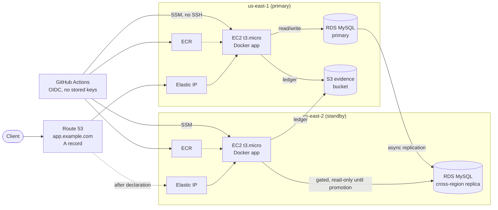

# Measured Multi-Region DR Lab

A working warm-standby disaster recovery lab on AWS, built to produce **measured**
RPO and RTO numbers from real drills rather than a diagram that claims them.

Two regions, one Dockerized application, an RDS MySQL primary with a
cross-region read replica, a Route 53 record that the drill rewrites on
declaration, and an S3 ledger that records every acknowledged write off the
instance that acknowledged it. A drill destroys the primary region, promotes the
replica, flips DNS, and records each step's timestamp from an API rather than a
stopwatch.

- **Design and reasoning:** [`docs/designs/measured-multi-region-dr-lab.md`](docs/designs/measured-multi-region-dr-lab.md)
- **How to deploy it:** [`docs/deployment.md`](docs/deployment.md)
- **How to run a drill:** [`docs/drills.md`](docs/drills.md)

## Architecture



The standby runs the same image against the replica from the start. Commits are
gated on `write_enabled_region` in the state record and the replica is
read-only, so it stays quiet until the drill authorises it. No container start
sits inside the measured RTO.

## What is actually measured

| Metric | Definition | Where it comes from |
|---|---|---|
| **RPO** | acknowledged rows − rows present on the promoted database | S3 ledger written by the app, compared with `MAX(id)` on the new primary |
| **Time to detection** | fault injected → CloudWatch alarm enters `ALARM` | `DescribeAlarmHistory` timestamp |
| **RTO** | alarm fires → writes sustained for 60s and DNS answers the new region | API timestamps plus a 60-second sustained-write window |
| **RTO segments** | decide, act, verify | the same timeline, split at declaration and promotion |

Rejected writes are reported separately as an availability number. They are
never folded into RPO.

## Results

Filled in from the JSON the drill writes to `results/` and uploads to S3.
Nothing in this table is an estimate.

| Drill | Fault | Time to detection | RTO | RPO | Date |
|---|---|---|---|---|---|
| Baseline (5 min) | none | — | — | 0 (no failover) | 2026-11-23 |
| Combined regional failover | primary RDS deleted, primary instance stopped | 140.1 s | 332.2 s | 0 rows | 2026-11-23 |
| Failback | rebuild region 1 and reverse | not run yet | — | — | — |

Baseline detail: 1,387 rows committed at 4.52 rows/second, 0 rejected writes,
replication lag p50 0.0s / p95 1.0s / max 1.0s.

Failover detail: 7,174 rows in the S3 ledger and 7,178 on the promoted database
at the fence. The ledger flushes every two seconds, so those four rows are the
measurement floor, not loss — no acknowledged write was missing. RTO split:
decide 6.6 s, act 216.9 s, verify 108.7 s. Of the act segment, 85.8 s is the
synchronous ledger scan used to compute RPO; the recovery-only path is about
246 s. DNS was verified with `TestDNSAnswer`, and the state record ended at
epoch 1, `active_region = us-east-2`, `phase = steady`.

## Repository layout

```
app/                     containerised write-path application
terraform/bootstrap/     state bucket (local state, one bucket)
terraform/persistent/    hosted zone, evidence bucket, ECR, OIDC roles, SNS
terraform/ephemeral/     VPC, EC2, RDS, replica, DNS record, health checks, alarms
scripts/                 baseline, deploy, drill, teardown, verify-empty, parser tests
results/                 drill output, also uploaded to the evidence bucket
.github/workflows/       app CI/CD, infra plan/apply, drill, teardown
docs/                    design RFC, deployment, drill runbook
```

## Cost

Designed for a $100 credit balance and destroyed after every session.

| Item | Running cost |
|---|---|
| 2 × t3.micro | ~$0.021/hour combined |
| 2 × db.t3.micro + 20 GB gp2 | ~$0.036/hour combined |
| Elastic IPs (attached) | $0 |
| Route 53 zone | $0.50/month |
| S3, ECR, CloudWatch | cents |

A full session of a few hours is a few dollars. The design deliberately
contains **no NAT gateway**, no load balancer, and no EKS cluster — the three
items that turn a lab into a monthly bill.

## Limits, stated plainly

- The application is synthetic. It has no unit tests; the harness has one small
  test for the alarm-history parser, because that parser failing silently is
  what defeated the first drill run.
- DNS failover is declaration-gated, not health-check-gated, because a
  health-check flip routes traffic to a read-only replica before promotion.
  Detection still comes from the Route 53 health check.
- Cross-region replica lag is measured, but the ledger's flush interval bounds
  how precisely a lost write can be attributed to a moment in time.
- The lab is single-AZ per region. Multi-AZ is a different failure model.
